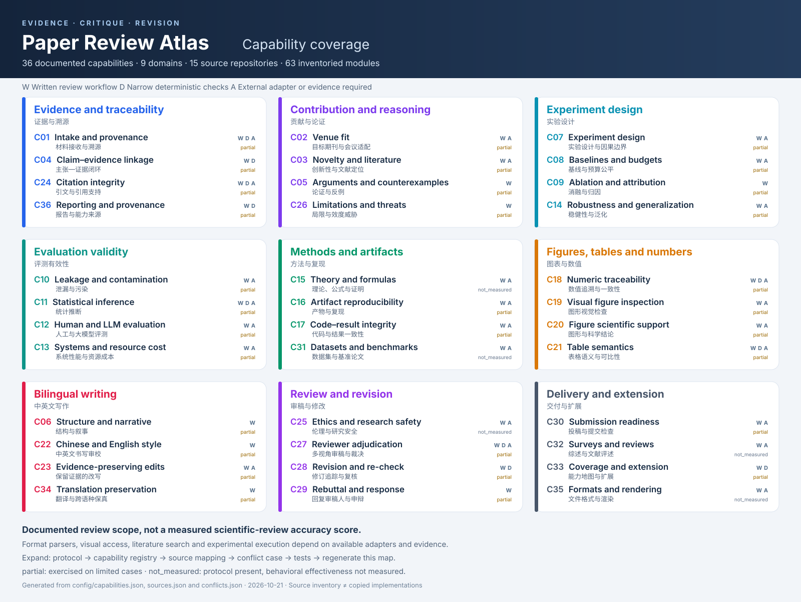

<!-- Generated by scripts/build_coverage.py. Edit config registries, then regenerate. -->
# Capability map / 能力地图

As of 2026-10-20. 36 documented review capabilities. Status is implementation scope, not a measured effectiveness score. Deterministic helpers operate only on supplied structured records; external adapters are requirements, not bundled tools.

## Reading this map / 如何阅读

- **W — review workflow / 审查协议**: original written instructions are present. This is not an empirical accuracy score.
- **D — deterministic helper / 确定性辅助**: named local checks cover narrow structured inputs; they do not establish semantic correctness.
- **A — external adapter / 外部适配要求**: the review can use the listed evidence/tool when available. The adapter is not bundled or automatically accessible.
- **implemented_workflow** describes written implementation; **partial_adapter** means the format route additionally depends on unbundled parsing/rendering tools. Neither status means all tests passed.

能力覆盖数统计的是已登记审查流程，不代表语义审稿正确率。缺失图像、原始数据、外部检索、运行环境或格式工具时，报告必须说明未评估的范围。

## Registry / 能力索引

| ID | Capability / 能力 | Scope | Protocol | Source families | Verification |
|---|---|---|---|---|---|
| C01 | Intake and provenance / 材料接收与溯源 | W / D / A | [review-contract](../skills/paper-review-atlas/references/review-contract.md) | [SRC01](SOURCES.md#src01), [SRC02](SOURCES.md#src02), [SRC03](SOURCES.md#src03), [SRC04](SOURCES.md#src04), [SRC05](SOURCES.md#src05), [SRC09](SOURCES.md#src09), [SRC10](SOURCES.md#src10), [SRC11](SOURCES.md#src11), [SRC12](SOURCES.md#src12), [SRC13](SOURCES.md#src13) | partial |
| C04 | Claim–evidence linkage / 主张—证据闭环 | W / D | [argument-novelty](../skills/paper-review-atlas/references/argument-novelty.md) | [SRC01](SOURCES.md#src01), [SRC03](SOURCES.md#src03), [SRC04](SOURCES.md#src04), [SRC05](SOURCES.md#src05), [SRC06](SOURCES.md#src06), [SRC07](SOURCES.md#src07), [SRC08](SOURCES.md#src08), [SRC11](SOURCES.md#src11), [SRC12](SOURCES.md#src12) | partial |
| C24 | Citation integrity / 引文与引用支持 | W / A | [citations-venues](../skills/paper-review-atlas/references/citations-venues.md) | [SRC01](SOURCES.md#src01), [SRC03](SOURCES.md#src03), [SRC04](SOURCES.md#src04), [SRC05](SOURCES.md#src05), [SRC11](SOURCES.md#src11) | not_measured |
| C36 | Reporting and provenance / 报告与能力来源 | W / D | [input-output](../skills/paper-review-atlas/references/input-output.md) | [SRC01](SOURCES.md#src01), [SRC02](SOURCES.md#src02), [SRC03](SOURCES.md#src03), [SRC05](SOURCES.md#src05), [SRC09](SOURCES.md#src09) | partial |
| C02 | Venue fit / 目标期刊与会议适配 | W / A | [citations-venues](../skills/paper-review-atlas/references/citations-venues.md) | [SRC01](SOURCES.md#src01), [SRC02](SOURCES.md#src02), [SRC05](SOURCES.md#src05), [SRC07](SOURCES.md#src07), [SRC08](SOURCES.md#src08) | not_measured |
| C03 | Novelty and literature / 创新性与文献定位 | W / A | [argument-novelty](../skills/paper-review-atlas/references/argument-novelty.md) | [SRC01](SOURCES.md#src01), [SRC03](SOURCES.md#src03), [SRC05](SOURCES.md#src05), [SRC06](SOURCES.md#src06) | not_measured |
| C05 | Arguments and counterexamples / 论证与反例 | W | [argument-novelty](../skills/paper-review-atlas/references/argument-novelty.md) | [SRC01](SOURCES.md#src01), [SRC02](SOURCES.md#src02), [SRC05](SOURCES.md#src05), [SRC06](SOURCES.md#src06), [SRC08](SOURCES.md#src08), [SRC13](SOURCES.md#src13) | partial |
| C26 | Limitations and threats / 局限与效度威胁 | W | [argument-novelty](../skills/paper-review-atlas/references/argument-novelty.md) | [SRC01](SOURCES.md#src01), [SRC05](SOURCES.md#src05) | partial |
| C07 | Experiment design / 实验设计与因果边界 | W / A | [experiments-statistics](../skills/paper-review-atlas/references/experiments-statistics.md) | [SRC01](SOURCES.md#src01), [SRC02](SOURCES.md#src02), [SRC05](SOURCES.md#src05), [SRC06](SOURCES.md#src06), [SRC08](SOURCES.md#src08), [SRC10](SOURCES.md#src10), [SRC13](SOURCES.md#src13) | partial |
| C08 | Baselines and budgets / 基线与预算公平 | W / A | [experiments-statistics](../skills/paper-review-atlas/references/experiments-statistics.md) | [SRC01](SOURCES.md#src01), [SRC06](SOURCES.md#src06), [SRC08](SOURCES.md#src08) | partial |
| C09 | Ablation and attribution / 消融与归因 | W | [experiments-statistics](../skills/paper-review-atlas/references/experiments-statistics.md) | [SRC01](SOURCES.md#src01), [SRC08](SOURCES.md#src08) | partial |
| C14 | Robustness and generalization / 稳健性与泛化 | W / A | [experiments-statistics](../skills/paper-review-atlas/references/experiments-statistics.md) | [SRC01](SOURCES.md#src01), [SRC05](SOURCES.md#src05), [SRC08](SOURCES.md#src08) | partial |
| C10 | Leakage and contamination / 泄漏与污染 | W / A | [experiments-statistics](../skills/paper-review-atlas/references/experiments-statistics.md) | [SRC01](SOURCES.md#src01), [SRC05](SOURCES.md#src05), [SRC06](SOURCES.md#src06) | partial |
| C11 | Statistical inference / 统计推断 | W / D / A | [experiments-statistics](../skills/paper-review-atlas/references/experiments-statistics.md) | [SRC01](SOURCES.md#src01), [SRC02](SOURCES.md#src02), [SRC05](SOURCES.md#src05), [SRC08](SOURCES.md#src08), [SRC11](SOURCES.md#src11), [SRC13](SOURCES.md#src13) | partial |
| C12 | Human and LLM evaluation / 人工与大模型评测 | W / A | [experiments-statistics](../skills/paper-review-atlas/references/experiments-statistics.md) | [SRC01](SOURCES.md#src01), [SRC05](SOURCES.md#src05) | partial |
| C13 | Systems and resource cost / 系统性能与资源成本 | W / A | [experiments-statistics](../skills/paper-review-atlas/references/experiments-statistics.md) | [SRC01](SOURCES.md#src01), [SRC06](SOURCES.md#src06) | partial |
| C15 | Theory and formulas / 理论、公式与证明 | W / A | [formal-theory](../skills/paper-review-atlas/references/formal-theory.md) | [SRC01](SOURCES.md#src01), [SRC05](SOURCES.md#src05) | not_measured |
| C16 | Artifact reproducibility / 产物与复现 | W / A | [code-reproducibility](../skills/paper-review-atlas/references/code-reproducibility.md) | [SRC01](SOURCES.md#src01), [SRC06](SOURCES.md#src06), [SRC12](SOURCES.md#src12) | partial |
| C17 | Code–result integrity / 代码与结果一致性 | W / A | [code-reproducibility](../skills/paper-review-atlas/references/code-reproducibility.md) | [SRC01](SOURCES.md#src01), [SRC06](SOURCES.md#src06) | partial |
| C31 | Datasets and benchmarks / 数据集与基准论文 | W / A | [argument-novelty](../skills/paper-review-atlas/references/argument-novelty.md) | [SRC01](SOURCES.md#src01) | not_measured |
| C18 | Numeric traceability / 数值追溯与一致性 | W / D / A | [figures-tables](../skills/paper-review-atlas/references/figures-tables.md) | [SRC01](SOURCES.md#src01), [SRC03](SOURCES.md#src03), [SRC05](SOURCES.md#src05), [SRC06](SOURCES.md#src06), [SRC11](SOURCES.md#src11) | partial |
| C19 | Visual figure inspection / 图形视觉检查 | W / A | [figures-tables](../skills/paper-review-atlas/references/figures-tables.md) | [SRC01](SOURCES.md#src01), [SRC03](SOURCES.md#src03), [SRC04](SOURCES.md#src04), [SRC05](SOURCES.md#src05), [SRC07](SOURCES.md#src07), [SRC08](SOURCES.md#src08) | partial |
| C20 | Figure scientific support / 图形与科学结论 | W / A | [figures-tables](../skills/paper-review-atlas/references/figures-tables.md) | [SRC01](SOURCES.md#src01), [SRC04](SOURCES.md#src04), [SRC05](SOURCES.md#src05), [SRC06](SOURCES.md#src06), [SRC07](SOURCES.md#src07), [SRC08](SOURCES.md#src08) | partial |
| C21 | Table semantics / 表格语义与可比性 | W / D / A | [figures-tables](../skills/paper-review-atlas/references/figures-tables.md) | [SRC01](SOURCES.md#src01), [SRC04](SOURCES.md#src04), [SRC05](SOURCES.md#src05), [SRC06](SOURCES.md#src06), [SRC07](SOURCES.md#src07), [SRC08](SOURCES.md#src08) | partial |
| C06 | Structure and narrative / 结构与叙事 | W | [bilingual-writing](../skills/paper-review-atlas/references/bilingual-writing.md) | [SRC01](SOURCES.md#src01), [SRC03](SOURCES.md#src03), [SRC04](SOURCES.md#src04), [SRC05](SOURCES.md#src05), [SRC07](SOURCES.md#src07), [SRC11](SOURCES.md#src11), [SRC12](SOURCES.md#src12) | partial |
| C22 | Chinese and English style / 中英文书写审校 | W | [bilingual-writing](../skills/paper-review-atlas/references/bilingual-writing.md) | [SRC01](SOURCES.md#src01), [SRC03](SOURCES.md#src03), [SRC04](SOURCES.md#src04), [SRC05](SOURCES.md#src05), [SRC07](SOURCES.md#src07), [SRC09](SOURCES.md#src09), [SRC10](SOURCES.md#src10) | partial |
| C23 | Evidence-preserving edits / 保留证据的改写 | W / A | [bilingual-writing](../skills/paper-review-atlas/references/bilingual-writing.md) | [SRC01](SOURCES.md#src01), [SRC03](SOURCES.md#src03), [SRC04](SOURCES.md#src04), [SRC05](SOURCES.md#src05), [SRC06](SOURCES.md#src06), [SRC07](SOURCES.md#src07), [SRC12](SOURCES.md#src12) | partial |
| C34 | Translation preservation / 翻译与跨语种保真 | W | [bilingual-writing](../skills/paper-review-atlas/references/bilingual-writing.md) | [SRC02](SOURCES.md#src02), [SRC03](SOURCES.md#src03), [SRC04](SOURCES.md#src04), [SRC09](SOURCES.md#src09), [SRC10](SOURCES.md#src10) | partial |
| C25 | Ethics and research safety / 伦理与研究安全 | W / A | [review-contract](../skills/paper-review-atlas/references/review-contract.md) | [SRC01](SOURCES.md#src01), [SRC05](SOURCES.md#src05), [SRC13](SOURCES.md#src13) | not_measured |
| C27 | Reviewer adjudication / 多视角审稿与裁决 | W / A | [adversarial-review](../skills/paper-review-atlas/references/adversarial-review.md) | [SRC01](SOURCES.md#src01), [SRC02](SOURCES.md#src02), [SRC05](SOURCES.md#src05), [SRC06](SOURCES.md#src06), [SRC07](SOURCES.md#src07), [SRC08](SOURCES.md#src08), [SRC09](SOURCES.md#src09), [SRC10](SOURCES.md#src10), [SRC11](SOURCES.md#src11), [SRC13](SOURCES.md#src13) | partial |
| C28 | Revision and re-check / 修订追踪与复核 | W / D | [revision-rebuttal](../skills/paper-review-atlas/references/revision-rebuttal.md) | [SRC01](SOURCES.md#src01), [SRC02](SOURCES.md#src02), [SRC03](SOURCES.md#src03), [SRC04](SOURCES.md#src04), [SRC06](SOURCES.md#src06), [SRC12](SOURCES.md#src12), [SRC13](SOURCES.md#src13) | partial |
| C29 | Rebuttal and response / 回复审稿人与申辩 | W | [revision-rebuttal](../skills/paper-review-atlas/references/revision-rebuttal.md) | [SRC01](SOURCES.md#src01), [SRC02](SOURCES.md#src02), [SRC08](SOURCES.md#src08) | not_measured |
| C30 | Submission readiness / 投稿与提交检查 | W / A | [citations-venues](../skills/paper-review-atlas/references/citations-venues.md) | [SRC01](SOURCES.md#src01), [SRC03](SOURCES.md#src03), [SRC04](SOURCES.md#src04), [SRC07](SOURCES.md#src07), [SRC11](SOURCES.md#src11), [SRC12](SOURCES.md#src12) | not_measured |
| C32 | Surveys and reviews / 综述与文献评述 | W / A | [domain-agent](../skills/paper-review-atlas/references/domain-agent.md) | [SRC05](SOURCES.md#src05), [SRC09](SOURCES.md#src09), [SRC13](SOURCES.md#src13) | not_measured |
| C33 | Coverage and extension / 能力地图与扩展 | W / D | [input-output](../skills/paper-review-atlas/references/input-output.md) | Original Atlas infrastructure | partial |
| C35 | Formats and rendering / 文件格式与渲染 | W / A | [input-output](../skills/paper-review-atlas/references/input-output.md) | [SRC03](SOURCES.md#src03), [SRC04](SOURCES.md#src04), [SRC10](SOURCES.md#src10) | not_measured |

## Capability boundaries / 每项能力的边界

### C01 — Intake and provenance / 材料接收与溯源

resolve_under_root only confines evidence paths; it does not authenticate provenance. Inventory and evidence states do not prove that missing material does not exist.

**Local helpers:** `resolve_under_root`

**External requirements:** PDF/DOCX extraction; OCR when needed

**Conflict cases:** CFX10

**Verification scope:** Exercised in two fresh-context synthetic full reviews. Specific supported checks and correct controls are recorded in the reports/rubric; this is not a measured real-paper accuracy or full-domain coverage claim.

- [docs/validation/forward-en.md](../docs/validation/forward-en.md)
- [docs/validation/forward-zh.md](../docs/validation/forward-zh.md)
- [docs/validation/behavioral-rubric.md](../docs/validation/behavioral-rubric.md)

### C02 — Venue fit / 目标期刊与会议适配

Venue eligibility and required checks must be looked up when time-sensitive; no invented acceptance probability.

**Local helpers:** None; model/human review protocol.

**External requirements:** Current official venue instructions

**Conflict cases:** CFX03

**Verification scope:** Documented protocol; deterministic and synthetic checks are reported separately and do not establish full semantic effectiveness.

### C03 — Novelty and literature / 创新性与文献定位

Novelty is bounded by searched sources and dates; a search cannot prove global absence.

**Local helpers:** None; model/human review protocol.

**External requirements:** Literature search and full-text access

**Conflict cases:** Registry consistency and generation checks.

**Verification scope:** Documented protocol; deterministic and synthetic checks are reported separately and do not establish full semantic effectiveness.

### C04 — Claim–evidence linkage / 主张—证据闭环

verify_quote checks exact source text and position, not semantic support. Semantic entailment requires reasoned review; a matched quotation alone is not support.

**Local helpers:** `verify_quote`

**External requirements:** No additional adapter requirement specified.

**Conflict cases:** CFX07

**Verification scope:** Exercised in two fresh-context synthetic full reviews. Specific supported checks and correct controls are recorded in the reports/rubric; this is not a measured real-paper accuracy or full-domain coverage claim.

- [docs/validation/forward-en.md](../docs/validation/forward-en.md)
- [docs/validation/forward-zh.md](../docs/validation/forward-zh.md)
- [docs/validation/behavioral-rubric.md](../docs/validation/behavioral-rubric.md)

### C05 — Arguments and counterexamples / 论证与反例

Counterexamples are hypotheses until established; disagreement is not proof of invalidity.

**Local helpers:** None; model/human review protocol.

**External requirements:** No additional adapter requirement specified.

**Conflict cases:** CFX02, CFX15

**Verification scope:** Exercised in two fresh-context synthetic full reviews. Specific supported checks and correct controls are recorded in the reports/rubric; this is not a measured real-paper accuracy or full-domain coverage claim.

- [docs/validation/forward-en.md](../docs/validation/forward-en.md)
- [docs/validation/forward-zh.md](../docs/validation/forward-zh.md)
- [docs/validation/behavioral-rubric.md](../docs/validation/behavioral-rubric.md)

### C06 — Structure and narrative / 结构与叙事

Style is subordinate to the paper purpose, discipline and evidence.

**Local helpers:** None; model/human review protocol.

**External requirements:** No additional adapter requirement specified.

**Conflict cases:** CFX05

**Verification scope:** Exercised in two fresh-context synthetic full reviews. Specific supported checks and correct controls are recorded in the reports/rubric; this is not a measured real-paper accuracy or full-domain coverage claim.

- [docs/validation/forward-en.md](../docs/validation/forward-en.md)
- [docs/validation/forward-zh.md](../docs/validation/forward-zh.md)
- [docs/validation/behavioral-rubric.md](../docs/validation/behavioral-rubric.md)
- [docs/validation/forward-control.md](../docs/validation/forward-control.md)

### C07 — Experiment design / 实验设计与因果边界

Clinical, qualitative, observational and ML studies require different design checks.

**Local helpers:** None; model/human review protocol.

**External requirements:** Domain-specific study standards as applicable

**Conflict cases:** CFX04, CFX08

**Verification scope:** Exercised in two fresh-context synthetic full reviews. Specific supported checks and correct controls are recorded in the reports/rubric; this is not a measured real-paper accuracy or full-domain coverage claim.

- [docs/validation/forward-en.md](../docs/validation/forward-en.md)
- [docs/validation/forward-zh.md](../docs/validation/forward-zh.md)
- [docs/validation/behavioral-rubric.md](../docs/validation/behavioral-rubric.md)

### C08 — Baselines and budgets / 基线与预算公平

Baseline fairness cannot be inferred from names alone.

**Local helpers:** None; model/human review protocol.

**External requirements:** Training/evaluation logs and configuration

**Conflict cases:** Registry consistency and generation checks.

**Verification scope:** Exercised in two fresh-context synthetic full reviews. Specific supported checks and correct controls are recorded in the reports/rubric; this is not a measured real-paper accuracy or full-domain coverage claim.

- [docs/validation/forward-en.md](../docs/validation/forward-en.md)
- [docs/validation/forward-zh.md](../docs/validation/forward-zh.md)
- [docs/validation/behavioral-rubric.md](../docs/validation/behavioral-rubric.md)

### C09 — Ablation and attribution / 消融与归因

Changing multiple factors limits component-specific attribution.

**Local helpers:** None; model/human review protocol.

**External requirements:** No additional adapter requirement specified.

**Conflict cases:** Registry consistency and generation checks.

**Verification scope:** Exercised in two fresh-context synthetic full reviews. Specific supported checks and correct controls are recorded in the reports/rubric; this is not a measured real-paper accuracy or full-domain coverage claim.

- [docs/validation/forward-en.md](../docs/validation/forward-en.md)
- [docs/validation/forward-zh.md](../docs/validation/forward-zh.md)
- [docs/validation/behavioral-rubric.md](../docs/validation/behavioral-rubric.md)

### C10 — Leakage and contamination / 泄漏与污染

No access to provenance means not assessable, not automatically contaminated.

**Local helpers:** None; model/human review protocol.

**External requirements:** Dataset lineage and split inspection

**Conflict cases:** CFX10

**Verification scope:** Exercised in two fresh-context synthetic full reviews. Specific supported checks and correct controls are recorded in the reports/rubric; this is not a measured real-paper accuracy or full-domain coverage claim.

- [docs/validation/forward-en.md](../docs/validation/forward-en.md)
- [docs/validation/forward-zh.md](../docs/validation/forward-zh.md)
- [docs/validation/behavioral-rubric.md](../docs/validation/behavioral-rubric.md)

### C11 — Statistical inference / 统计推断

paired_run_stats computes matched-run descriptive summaries; it does not supply p-values, confidence intervals or a valid inference design. The experimental unit, dependence structure and preregistration govern valid inference; text-only review is limited.

**Local helpers:** `paired_run_stats`

**External requirements:** Statistical environment and raw data for recomputation

**Conflict cases:** CFX04, CFX08

**Verification scope:** Exercised in two fresh-context synthetic full reviews. Specific supported checks and correct controls are recorded in the reports/rubric; this is not a measured real-paper accuracy or full-domain coverage claim.

- [docs/validation/forward-en.md](../docs/validation/forward-en.md)
- [docs/validation/forward-zh.md](../docs/validation/forward-zh.md)
- [docs/validation/behavioral-rubric.md](../docs/validation/behavioral-rubric.md)

### C12 — Human and LLM evaluation / 人工与大模型评测

Agreement, blinding and bias need actual records; same-model judges are not independent evidence.

**Local helpers:** None; model/human review protocol.

**External requirements:** Annotator/judge records and evaluation runs

**Conflict cases:** CFX04, CFX09

**Verification scope:** Exercised in two fresh-context synthetic full reviews. Specific supported checks and correct controls are recorded in the reports/rubric; this is not a measured real-paper accuracy or full-domain coverage claim.

- [docs/validation/forward-en.md](../docs/validation/forward-en.md)
- [docs/validation/forward-zh.md](../docs/validation/forward-zh.md)
- [docs/validation/behavioral-rubric.md](../docs/validation/behavioral-rubric.md)

### C13 — Systems and resource cost / 系统性能与资源成本

Wall time, throughput, latency, memory, energy and cost require comparable measurement conditions.

**Local helpers:** None; model/human review protocol.

**External requirements:** Hardware/runtime logs and measurement environment

**Conflict cases:** Registry consistency and generation checks.

**Verification scope:** Exercised in two fresh-context synthetic full reviews. Specific supported checks and correct controls are recorded in the reports/rubric; this is not a measured real-paper accuracy or full-domain coverage claim.

- [docs/validation/forward-en.md](../docs/validation/forward-en.md)
- [docs/validation/forward-zh.md](../docs/validation/forward-zh.md)
- [docs/validation/behavioral-rubric.md](../docs/validation/behavioral-rubric.md)

### C14 — Robustness and generalization / 稳健性与泛化

Unrun stress tests are proposed experiments, never completed evidence.

**Local helpers:** None; model/human review protocol.

**External requirements:** External data or reruns for new tests

**Conflict cases:** Registry consistency and generation checks.

**Verification scope:** Exercised in two fresh-context synthetic full reviews. Specific supported checks and correct controls are recorded in the reports/rubric; this is not a measured real-paper accuracy or full-domain coverage claim.

- [docs/validation/forward-en.md](../docs/validation/forward-en.md)
- [docs/validation/forward-zh.md](../docs/validation/forward-zh.md)
- [docs/validation/behavioral-rubric.md](../docs/validation/behavioral-rubric.md)

### C15 — Theory and formulas / 理论、公式与证明

Reasoned proof inspection is not machine-checked verification; assumptions and counterexamples remain explicit.

**Local helpers:** None; model/human review protocol.

**External requirements:** Symbolic algebra/proof assistants when appropriate

**Conflict cases:** Registry consistency and generation checks.

**Verification scope:** Documented protocol; deterministic and synthetic checks are reported separately and do not establish full semantic effectiveness.

### C16 — Artifact reproducibility / 产物与复现

A reproducibility plan is not a reproduced result; execution must be logged.

**Local helpers:** None; model/human review protocol.

**External requirements:** Repository, environment and authorized compute

**Conflict cases:** CFX13, CFX16

**Verification scope:** Exercised in two fresh-context synthetic full reviews. Specific supported checks and correct controls are recorded in the reports/rubric; this is not a measured real-paper accuracy or full-domain coverage claim.

- [docs/validation/forward-en.md](../docs/validation/forward-en.md)
- [docs/validation/forward-zh.md](../docs/validation/forward-zh.md)
- [docs/validation/behavioral-rubric.md](../docs/validation/behavioral-rubric.md)

### C17 — Code–result integrity / 代码与结果一致性

Static inspection cannot establish that code ran or that outputs came from a specific run.

**Local helpers:** None; model/human review protocol.

**External requirements:** Source code, raw outputs and execution traces

**Conflict cases:** CFX13

**Verification scope:** Exercised in two fresh-context synthetic full reviews. Specific supported checks and correct controls are recorded in the reports/rubric; this is not a measured real-paper accuracy or full-domain coverage claim.

- [docs/validation/forward-en.md](../docs/validation/forward-en.md)
- [docs/validation/forward-zh.md](../docs/validation/forward-zh.md)
- [docs/validation/behavioral-rubric.md](../docs/validation/behavioral-rubric.md)

### C18 — Numeric traceability / 数值追溯与一致性

Deterministic helpers check supplied records only; they do not extract all paper numbers or validate the underlying experiment.

**Local helpers:** `reconcile_number`

**External requirements:** Machine-readable result exports

**Conflict cases:** CFX01

**Verification scope:** Exercised in two fresh-context synthetic full reviews. Specific supported checks and correct controls are recorded in the reports/rubric; this is not a measured real-paper accuracy or full-domain coverage claim.

- [docs/validation/forward-en.md](../docs/validation/forward-en.md)
- [docs/validation/forward-zh.md](../docs/validation/forward-zh.md)
- [docs/validation/behavioral-rubric.md](../docs/validation/behavioral-rubric.md)
- [tests/test_audit_checks.py::NumericTests::test_relative_percent_and_percentage_points_are_distinct](../tests/test_audit_checks.py)

### C19 — Visual figure inspection / 图形视觉检查

Layout, glyphs, color and cropped content are not assessable from extracted text alone.

**Local helpers:** None; model/human review protocol.

**External requirements:** Actual figure images and vision/rendering access

**Conflict cases:** CFX05, CFX06, CFX12

**Verification scope:** Exercised in two fresh-context synthetic full reviews. Specific supported checks and correct controls are recorded in the reports/rubric; this is not a measured real-paper accuracy or full-domain coverage claim.

- [docs/validation/forward-en.md](../docs/validation/forward-en.md)
- [docs/validation/forward-zh.md](../docs/validation/forward-zh.md)
- [docs/validation/behavioral-rubric.md](../docs/validation/behavioral-rubric.md)

### C20 — Figure scientific support / 图形与科学结论

A visually clean figure does not establish claim support or data integrity.

**Local helpers:** None; model/human review protocol.

**External requirements:** Underlying data and figure source when needed

**Conflict cases:** CFX06, CFX12

**Verification scope:** Exercised in two fresh-context synthetic full reviews. Specific supported checks and correct controls are recorded in the reports/rubric; this is not a measured real-paper accuracy or full-domain coverage claim.

- [docs/validation/forward-en.md](../docs/validation/forward-en.md)
- [docs/validation/forward-zh.md](../docs/validation/forward-zh.md)
- [docs/validation/behavioral-rubric.md](../docs/validation/behavioral-rubric.md)

### C21 — Table semantics / 表格语义与可比性

reconcile_number checks supplied structured numeric records, not table meaning or automatic cell extraction. Footnotes, denominators, metric directions and uncertainty must be interpreted with the caption.

**Local helpers:** `reconcile_number`

**External requirements:** Table extraction or original source

**Conflict cases:** CFX01, CFX12

**Verification scope:** Exercised in two fresh-context synthetic full reviews. Specific supported checks and correct controls are recorded in the reports/rubric; this is not a measured real-paper accuracy or full-domain coverage claim.

- [docs/validation/forward-en.md](../docs/validation/forward-en.md)
- [docs/validation/forward-zh.md](../docs/validation/forward-zh.md)
- [docs/validation/behavioral-rubric.md](../docs/validation/behavioral-rubric.md)

### C22 — Chinese and English style / 中英文书写审校

Bilingual protocols are implemented; broad bilingual effectiveness has not been established by these tests.

**Local helpers:** None; model/human review protocol.

**External requirements:** No additional adapter requirement specified.

**Conflict cases:** CFX05, CFX07, CFX14

**Verification scope:** Exercised in two fresh-context synthetic full reviews. Specific supported checks and correct controls are recorded in the reports/rubric; this is not a measured real-paper accuracy or full-domain coverage claim.

- [docs/validation/forward-en.md](../docs/validation/forward-en.md)
- [docs/validation/forward-zh.md](../docs/validation/forward-zh.md)
- [docs/validation/behavioral-rubric.md](../docs/validation/behavioral-rubric.md)
- [docs/validation/forward-control.md](../docs/validation/forward-control.md)

### C23 — Evidence-preserving edits / 保留证据的改写

Edits preserve uncertainty, numerical values and causal scope; a user request to review does not itself request file mutation.

**Local helpers:** None; model/human review protocol.

**External requirements:** Document editing adapter for in-place changes

**Conflict cases:** CFX07, CFX11, CFX14

**Verification scope:** Exercised in two fresh-context synthetic full reviews. Specific supported checks and correct controls are recorded in the reports/rubric; this is not a measured real-paper accuracy or full-domain coverage claim.

- [docs/validation/forward-en.md](../docs/validation/forward-en.md)
- [docs/validation/forward-zh.md](../docs/validation/forward-zh.md)
- [docs/validation/behavioral-rubric.md](../docs/validation/behavioral-rubric.md)
- [docs/validation/forward-control.md](../docs/validation/forward-control.md)

### C24 — Citation integrity / 引文与引用支持

DOI identity and bibliographic existence do not establish that the source supports the cited claim.

**Local helpers:** None; model/human review protocol.

**External requirements:** Bibliographic lookup and full text

**Conflict cases:** Registry consistency and generation checks.

**Verification scope:** Documented protocol; deterministic and synthetic checks are reported separately and do not establish full semantic effectiveness.

### C25 — Ethics and research safety / 伦理与研究安全

Flag bounded concerns with evidence; neither missing disclosure nor a visual anomaly alone proves misconduct.

**Local helpers:** None; model/human review protocol.

**External requirements:** Relevant domain and venue policies

**Conflict cases:** CFX08, CFX10

**Verification scope:** Documented protocol; deterministic and synthetic checks are reported separately and do not establish full semantic effectiveness.

### C26 — Limitations and threats / 局限与效度威胁

Prioritize limitations that affect actual claims; do not manufacture flaws to fill a quota.

**Local helpers:** None; model/human review protocol.

**External requirements:** No additional adapter requirement specified.

**Conflict cases:** CFX02

**Verification scope:** Exercised in two fresh-context synthetic full reviews. Specific supported checks and correct controls are recorded in the reports/rubric; this is not a measured real-paper accuracy or full-domain coverage claim.

- [docs/validation/forward-en.md](../docs/validation/forward-en.md)
- [docs/validation/forward-zh.md](../docs/validation/forward-zh.md)
- [docs/validation/behavioral-rubric.md](../docs/validation/behavioral-rubric.md)

### C27 — Reviewer adjudication / 多视角审稿与裁决

Multiple personas from one model are correlated viewpoints, not independent expert validation.

**Local helpers:** None; model/human review protocol.

**External requirements:** Optional independent-model or human review

**Conflict cases:** CFX02, CFX03, CFX05, CFX09, CFX10, CFX15

**Verification scope:** Exercised in two fresh-context synthetic full reviews. Specific supported checks and correct controls are recorded in the reports/rubric; this is not a measured real-paper accuracy or full-domain coverage claim.

- [docs/validation/forward-en.md](../docs/validation/forward-en.md)
- [docs/validation/forward-zh.md](../docs/validation/forward-zh.md)
- [docs/validation/behavioral-rubric.md](../docs/validation/behavioral-rubric.md)

### C28 — Revision and re-check / 修订追踪与复核

recheck_issue validates a supplied closure record and any declared supported recheck; manual-review notes are not independent semantic verification. Closure requires evidence and reviewer re-check; author assertion alone does not resolve an issue.

**Local helpers:** `recheck_issue`

**External requirements:** No additional adapter requirement specified.

**Conflict cases:** CFX11, CFX15, CFX16

**Verification scope:** Actual declarative mean checks demonstrate failed and successful closure; manual checks validate records only. No complete model-experiment rerun or longitudinal manuscript study was performed.

- [docs/validation/recheck-failed.json](../docs/validation/recheck-failed.json)
- [docs/validation/recheck-passed.json](../docs/validation/recheck-passed.json)
- [tests/test_audit_checks.py::RecheckTests::test_manual_closure_records_scope_and_requires_observations](../tests/test_audit_checks.py)

### C29 — Rebuttal and response / 回复审稿人与申辩

Responses must distinguish completed corrections from proposed work and justified disagreement.

**Local helpers:** None; model/human review protocol.

**External requirements:** No additional adapter requirement specified.

**Conflict cases:** CFX16

**Verification scope:** Documented protocol; deterministic and synthetic checks are reported separately and do not establish full semantic effectiveness.

### C30 — Submission readiness / 投稿与提交检查

Readiness is not acceptance; permissions to submit or message others are separate from preparing material.

**Local helpers:** None; model/human review protocol.

**External requirements:** Current venue rules and format tools

**Conflict cases:** CFX03, CFX11

**Verification scope:** Documented protocol; deterministic and synthetic checks are reported separately and do not establish full semantic effectiveness.

### C31 — Datasets and benchmarks / 数据集与基准论文

Licensing, representativeness and maintenance claims need inspectable documentation.

**Local helpers:** None; model/human review protocol.

**External requirements:** Dataset documentation and evaluation artifacts

**Conflict cases:** Registry consistency and generation checks.

**Verification scope:** Documented protocol; deterministic and synthetic checks are reported separately and do not establish full semantic effectiveness.

### C32 — Surveys and reviews / 综述与文献评述

A narrative survey is not automatically a systematic review or a clinical meta-analysis.

**Local helpers:** None; model/human review protocol.

**External requirements:** Search records and reporting standard for review type

**Conflict cases:** CFX08

**Verification scope:** Documented protocol; deterministic and synthetic checks are reported separately and do not establish full semantic effectiveness.

### C33 — Coverage and extension / 能力地图与扩展

Registry coverage shows implemented instructions, not measured real-world review accuracy.

**Local helpers:** `validate_registry`, `coverage_artifact_drift`

**External requirements:** No additional adapter requirement specified.

**Conflict cases:** Registry consistency and generation checks.

**Verification scope:** Registry reciprocity, generated map freshness and extension by C37 are tested in the repository. The generator is a repository maintenance tool, not part of the installed runtime; adding a real new scientific domain still needs behavioral validation.

- [tests/test_coverage.py::CoverageRegistryTests::test_xml_escaping_and_registry_extension_need_no_template_edit](../tests/test_coverage.py)
- [docs/validation/integration-review.md](../docs/validation/integration-review.md)

### C34 — Translation preservation / 翻译与跨语种保真

Translation must preserve uncertainty, comparisons, negation, numerical meaning and field terminology.

**Local helpers:** None; model/human review protocol.

**External requirements:** No additional adapter requirement specified.

**Conflict cases:** CFX14

**Verification scope:** Exercised in two fresh-context synthetic full reviews. Specific supported checks and correct controls are recorded in the reports/rubric; this is not a measured real-paper accuracy or full-domain coverage claim.

- [docs/validation/forward-en.md](../docs/validation/forward-en.md)
- [docs/validation/forward-zh.md](../docs/validation/forward-zh.md)
- [docs/validation/behavioral-rubric.md](../docs/validation/behavioral-rubric.md)
- [docs/validation/forward-control.md](../docs/validation/forward-control.md)

### C35 — Formats and rendering / 文件格式与渲染

No built-in PDF/DOCX/OCR/LaTeX/Typst parser or renderer is claimed; unavailable formats are reported explicitly.

**Local helpers:** None; model/human review protocol.

**External requirements:** PDF/OCR, DOCX, LaTeX and Typst adapters

**Conflict cases:** CFX06

**Verification scope:** Documented protocol; deterministic and synthetic checks are reported separately and do not establish full semantic effectiveness.

### C36 — Reporting and provenance / 报告与能力来源

Record validation checks structure and quote anchors, not the scientific truth of a finding. Record actual access, tools, tests and limitations; sourced capability descriptions do not inherit upstream benchmark results.

**Local helpers:** `validate_issue`, `validate_report`, `validate_registry`, `coverage_artifact_drift`

**External requirements:** No additional adapter requirement specified.

**Conflict cases:** CFX09, CFX12, CFX13, CFX16

**Verification scope:** Exercised in two fresh-context synthetic full reviews. Specific supported checks and correct controls are recorded in the reports/rubric; this is not a measured real-paper accuracy or full-domain coverage claim.

- [docs/validation/forward-en.md](../docs/validation/forward-en.md)
- [docs/validation/forward-zh.md](../docs/validation/forward-zh.md)
- [docs/validation/behavioral-rubric.md](../docs/validation/behavioral-rubric.md)

## Extending the map / 扩展步骤

1. Add or extend a protocol under `skills/paper-review-atlas/references/`. State the input evidence, review method, output, limits, and a realistic failure case.
2. Add a stable capability ID to `config/capabilities.json`; do not renumber existing IDs. Choose a group, bilingual titles, protocol path, actual helpers, required adapters and honest verification scope.
3. Map conceptual sources at module level in `config/sources.json`, recording consultation date, inspection depth and license uncertainty. Update reciprocal capability mappings. New original capabilities may have an empty sources list.
4. Add a policy conflict and regression case where behavior could conflict with an existing rule. Record a planned test before execution; attach concrete evidence only after running the test.
5. Run `python scripts/build_coverage.py`, then `python scripts/build_coverage.py --check` and the repository test suite. Commit registries and generated outputs together.
6. Describe remaining blind spots in the README and test report. Record model/version, prompts, inputs and grading method for behavioral evaluations; do not upgrade a workflow to measured effectiveness on a structural test alone.

## Open coverage gaps / 明确保留的扩展位置

- Validated domain adapters for clinical trials, qualitative studies, geophysics, formal verification and other specialist fields.
- Real PDF/OCR/DOCX/LaTeX/Typst adapters, visual inspection logs and source-data reconciliation.
- Blind bilingual benchmarks with expert-labeled false positives and false negatives; broader languages and discipline-specific terminology.
- Reproducible execution environments, trustworthy independent-review provenance and external bibliographic verification.
- Calibrated review-quality measures across real papers; no claim is made that the current scope guarantees completeness or acceptance.

See [source inventory](SOURCES.md), [conflict decisions](CONFLICTS.md), and the machine-readable registries for the exact scope.
