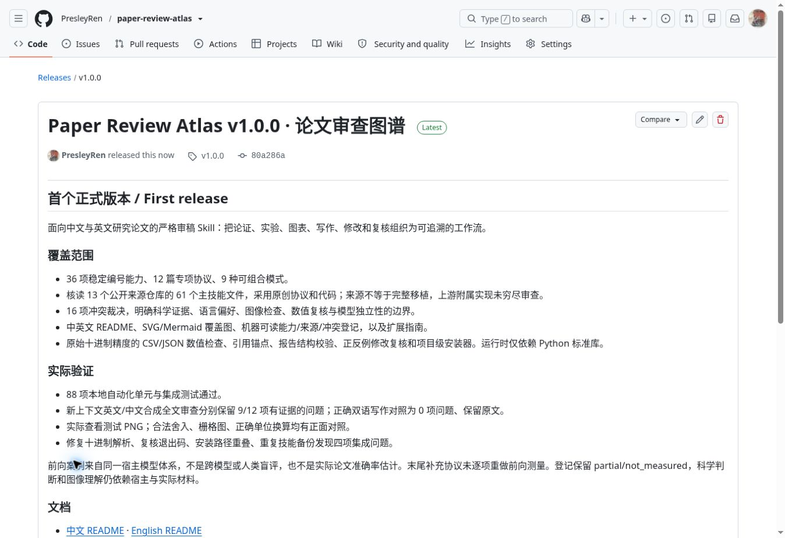

# 发布后核验 / Publication verification

日期：2026-10-20。此记录在版本发布后加入主分支；不改动 v1.0.0 标签对应的技能与测试内容。

- 仓库：[PresleyRen/paper-review-atlas](https://github.com/PresleyRen/paper-review-atlas)
- 正式版本：[Paper Review Atlas v1.0.0](https://github.com/PresleyRen/paper-review-atlas/releases/tag/v1.0.0)
- 标签提交：`80a286ad4f9bb7c9b9505ded5ede856e8a6aa6d7`
- 发布内容树：`68fea33d9cb0c512054f54e38512c13032dc2b22`

GitHub 创建的内容树与本地暂存的 81 个发布文件具有完全相同的 Git tree SHA。发布后从 v1.0.0 标签重新读取 SKILL.md、中英文 README、能力表、冲突表、验证记录、扩展指南与 SVG，并逐一核对 blob SHA，全部匹配。Release 页面显示 Latest、v1.0.0 和上述目标提交。

## 远端 CI

[v1.0.0 标签的 GitHub Actions 运行记录](https://github.com/PresleyRen/paper-review-atlas/actions/runs/39369209434)显示 `validate (3.10)` 与 `validate (3.12)` 均完成且成功；再次通过 GitHub run-jobs API 核对两项 job 及其步骤。详见 [结构化记录](ci-v1.0.0.json)。

两种 Python 版本都完成了自动化测试、运行包检查、生成图表一致性检查及 `verify-install`。这些结果验证声明的代码与包行为，不认证论文科学有效性或语义审稿准确率。

## 公开发布截图

截图来自发布成功后实际显示的 GitHub Release 页面，没有替换页面内容。能力范围、安装方法和已测量边界分别见仓库 README 与 [验证记录](../VALIDATION.md)。
